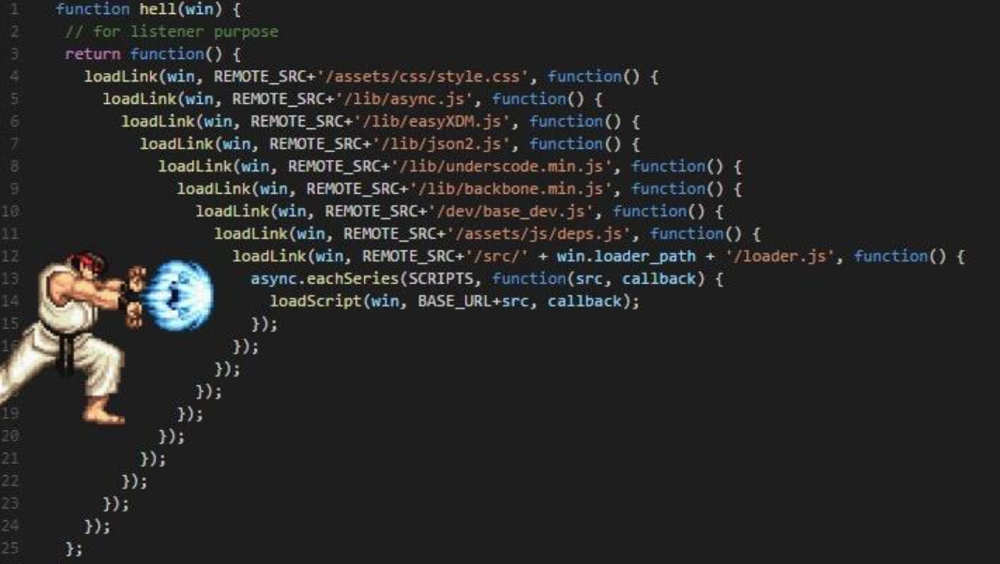

Hello,大家好,我们今天来聊一聊 js 中的`Promise`,希望能对它有进一步的认识.

## 它出现的原因是什么?

一个技术的出现一定是为了解决某一个问题或痛点,promise 也是这样的背景下出现的,它的出现将我们从异步的回调地狱中解脱了出来!
在 promise 出现之前,如果你想在这个异步任务完成之后,获取异步的任务的结果以及做一些后续的操作,那么我们书写异步任务的代码一般会是下边这个样子

```js
// 模拟一个长耗时任务
const req1 = (callback) => {
  setTimeout(() => {
    callback("done");
  }, 1000);
};
req1(console.log);
```

这样看似也没有什么问题.但是如果你有一堆的异步任务,而你的程序需要这些异步任务按照一个特定的顺序执行,那么问题就出现了.

这样的情况下,多次采用异步回调的方式就会形成非常经典的嵌套地狱 😝


而随着 es6 的出现,js 获得了原生级别的 promise 支持,改变了我们书写异步代码的方式,让我们从嵌套中得到了解脱.

## 如何使用 promise 来解决嵌套呢?

如果我们用 promise 来包装我们的任务,那么就不会出现回调地狱的问题了,我们来看一下代码:

```js
// 使用promise来包装任务
const req1P = () => {
  return new Promise((resolve) => {
    req1(() => {
      resolve("req1");
    });
  });
};
const req2P = () => {
  return new Promise((resolve) => {
    req2(() => {
      resolve("req2");
    });
  });
};
const req3P = () => {
  return new Promise((resolve) => {
    req3(() => {
      resolve("req3");
    });
  });
};

req1P()
  .then((msg1) => {
    return req2P().then((msg2) => {
      return [msg1, msg2];
    });
  })
  .then((msgs) => {
    return req3P().then((msg3) => {
      return [...msgs, msg3];
    });
  })
  .then((msgs) => {
    console.log(msgs);
  });
```

可以看到,我们的异步代码变成了链式的执行,不再是无限嵌套了,这样写代码就舒服多了.即使你的异步足够多,那么也只是增加这个链的长度,而不是增加嵌套的深度.

即使社区做了这么多努力改善我们的异步代码编写体验,我们还是会在一些地方看到有些奇怪的 promise 使用方式,比如下边这样的使用方式

```js
// 将promise重新打回地狱
req1P().then((msg1) => {
  req2P().then((msg2) => {
    req3P().then((msg3) => {
      console.log({
        msg1,
        msg2,
        msg3,
      });
    });
  });
});
```

它再次将 promise 打回了地狱 😀

## 为了理解 Promise 的原理,我们来手写实现一个 Promise

废话说了这么多,终于到重点了.我们需要自己手写一版的 promise 来彻底的理解它.接下里我们会根据`promiseA+`规范来一步一步实现一个完整的 promise,那么我们首先要了解一下什么是 promiseA+规范.

可以通过下边的链接来一睹规范详情:
[promiseA+规范](https://promisesaplus.com/)

文档是英文的,这里也有中文的翻译版本 😀:
[promiseA+规范中文翻译](https://www.ituring.com.cn/article/66566)

好的,有了规范内容,我们接下来就按照规范一步一步来实现一版我们自己的 promise 吧~

实现回大致分两步:

- 第一步先实现一个基本的 promise 实现,这部分基本上没什么难度,大致说一下整个运行的流程,结合平时对 promise 的使用不难理解这个过程。
- 第二步我们将实现 promise 的链式调用,以及规范中定义的 promise 的解决过程,我们到时候会专门书写一个函数`resolvePromise`来实现这个解决过程.

这一块建议配合视频食用,这里就不一步一步去讲解了.

[Promise 实现全过程](https://www.douyin.com/user/self?from_tab_name=main&modal_id=7321772418794540303&showTab=post)

可以看到在视频的最后,我们通过了全部的测试用例~,`我穿山甲的任务完成啦`~

完整代码:

```js
function queueTask(fn) {
  setTimeout(fn);
}
class PdPromise {
  static PENDING = "pending";
  static FULFILLED = "fulfilled";
  static REJECTED = "rejected";

  #status = PdPromise.PENDING;
  #value = null;
  #reason = null;

  #fulfilledCallbacks = [];
  #rejectedCallbacks = [];

  constructor(executor) {
    try {
      executor(this.resolve, this.reject);
    } catch (e) {
      this.reject(e);
    }
  }
  resolve = (value) => {
    if (this.#status !== PdPromise.PENDING) return;
    /**
     * 如果value是一个promise,那么这个Promise实例会根据value这个Promise的解决时机进行reslove或者reject
     * 此处逻辑并不在规范之内,但是原生的Promise的行为是这样的,所以我们加上
     *  */
    if (value instanceof PdPromise) {
      return value.then(
        (value) => this.resolve(value),
        (reason) => this.reject(reason)
      );
    }
    this.#status = PdPromise.FULFILLED;
    this.#value = value;
    this.#fulfilledCallbacks.forEach((fn) => fn());
  };
  reject = (reason) => {
    if (this.#status !== PdPromise.PENDING) return;
    this.#status = PdPromise.REJECTED;
    this.#reason = reason;
    this.#rejectedCallbacks.forEach((fn) => fn());
  };
  then = (onfulfilled, onrejected) => {
    const onfulfilledBak = onfulfilled;
    const onrejectedBak = onrejected;

    onfulfilled = typeof onfulfilled === "function" ? onfulfilled : () => this.#value;
    onrejected = typeof onrejected === "function" ? onrejected : () => this.#reason;
    const promise = new PdPromise((resolve, reject) => {
      const resolveValue = (value) => {
        if (typeof onfulfilledBak === "function") {
          const x = onfulfilled(value);
          resolvePromise(promise, x, resolve, reject);
        } else {
          resolve(value);
        }
      };

      if (this.#status === PdPromise.FULFILLED) {
        queueTask(() => {
          try {
            resolveValue(this.#value);
          } catch (e) {
            reject(e);
          }
        });
      }
      if (this.#status === PdPromise.REJECTED) {
        queueTask(() => {
          try {
            if (typeof onrejectedBak === "function") {
              const x = onrejected(this.#reason);
              resolvePromise(promise, x, resolve, reject);
            } else {
              reject(this.#reason);
            }
          } catch (e) {
            reject(e);
          }
        });
      }
      if (this.#status === PdPromise.PENDING) {
        this.#fulfilledCallbacks.push(() =>
          queueTask(() => {
            try {
              resolveValue(this.#value);
            } catch (e) {
              reject(e);
            }
          })
        );
        this.#rejectedCallbacks.push(() =>
          queueTask(() => {
            try {
              if (typeof onrejectedBak === "function") {
                const x = onrejected(this.#reason);
                resolvePromise(promise, x, resolve, reject);
              } else {
                reject(this.#reason);
              }
            } catch (e) {
              reject(e);
            }
          })
        );
      }
    });
    return promise;
  };
}
function resolvePromise(promise, x, resolve, reject) {
  if (promise === x) {
    return reject(new TypeError("The promise and the return value are the same"));
  }

  if (x !== null && (typeof x === "function" || typeof x === "object")) {
    let then;
    try {
      then = x.then;
    } catch (e) {
      reject(e);
    }
    // 如果then是一个函数,我们就理解这个x是一个promise
    if (typeof then === "function") {
      let called = false;
      try {
        then.call(
          x,
          function (y) {
            if (called) return;
            called = true;
            resolvePromise(promise, y, resolve, reject);
          },
          function (r) {
            if (called) return;
            called = true;
            reject(r);
          }
        );
      } catch (e) {
        if (called) return;
        reject(e);
      }
    } else {
      // 如果then不是一个函数,说明x只是有一个then属性普通对象
      resolve(x);
    }
  } else {
    resolve(x);
  }
}
PdPromise.deferred = function () {
  var result = {};
  result.promise = new PdPromise(function (resolve, reject) {
    result.resolve = resolve;
    result.reject = reject;
  });
  return result;
};
module.exports = PdPromise;
```

## async/await

从`ES7`发布后,`async`以及`await`现在已经用得最多的一种异步解决方案,这两个关键字基本上成一对一(多)出现的

它让我们像书写同步代码一样书写异步代码,它让我们在书写异步代码时,没有了`嵌套`和`链式`的烦恼.

#### 　我们先来看下它的基础用法

首先你要用 async 来标记一个函数是异步函数,然后在函数内部使用`await`来等待`Promise`的交付结果,让我们感觉就像是在书写同步代码一样,这样的一个好处是,我们在写异步代码的`嵌套`和`链式`都消失了.

```js
const sleep = (time) => {
  return new PdPromise((resolve) => {
    setTimeout(() => resolve(`sleep ${time}ms`), time);
  });
};
async function asyncFn() {
  const res1 = await sleep(1000);
  console.log(res1);
  const res2 = await sleep(2000);
  console.log(res2);
}
asyncFn();
```

#### 那么我们有没有可能来手写实现一版呢？

介绍完用法,我们是否也能自己写一版呢?答案是可以的.因为 async 和 await 本质上是 promise 和生成器迭代器的语法糖.那么借助生成器和迭代器,我们也可以实现自己的`async`以及`await`.

关于生成器和迭代器这一块就不详细展开了,感兴趣的可以去看一下红宝书相关的章节,讲的非常清楚.

既然生成器可以让我们暂停当前执行,等到下一次调用`next`才会再次恢复执行,那么我们可以结合 `promise` ,让 `promise` 在被解决或者被拒绝的时候的调用`next`,那么就可以模拟类似于 `async`和 `await` 的效果了.

```js
// 实现模拟 async/await
function myAsync(generatorFunc) {
  return (function () {
    // 调用生成器函数,获取一个迭代器
    const gen = generatorFunc.apply(this, arguments);
    // 返回一个promise,这个promise相当于一个启动promise,会在我们第一次调用next的时候被解决
    return new PdPromise((resolve, reject) => {
      let result = {};
      // 这个value参数是上次调用next传递进来的参数
      const next = (value) => {
        try {
          // 这个result中的value就是yield后边表达式返回的数据了,注意区分,容易搞混
          result = gen.next(value);
        } catch (err) {
          // 如果出现错误,直接拒绝这个Promise
          reject(err);
        }
        // 判断是否迭代完成
        if (result.done) {
          // 如果已经完成,那么直接解决这个promise
          resolve(result.value);
        } else {
          // 如果没有完成迭代,则进行下一次迭代
          // 这里我们会对value进行一次包装,保证一定会是一个Promise
          PdPromise.resolve(result.value).then(
            (value) => {
              // 在这个promise被解决的时候,调用next
              next(value);
            },
            (reason) => {
              // 在这个promise被拒绝的时候,调用throw
              gen.throw(reason);
            }
          );
        }
      };

      // 这里只是为了启动迭代,传参也没有实际意义
      next();
    });
  })();
}
const sleep = (time) => {
  return new PdPromise((resolve) => {
    setTimeout(() => resolve(`sleep ${time} ms`), time);
  });
};
function* generatorFunction() {
  // 这里的yield你就可以理解为await
  const result1 = yield sleep(1000);
  console.log("result1", result1);
  const result2 = yield sleep(2000);
  console.log("result2", result2);
  const result3 = yield "test no-promise";
  return [result1, result2, result3];
}
const asyncFunctionP = myAsync(generatorFunction);
asyncFunctionP.then((res) => {
  console.log(res);
});
```

我已经在尽可能的在注释中解释我们在做什么,相信你能看明白,但前提是你一定要熟悉生成器和迭代器的相关知识.其核心原理就是让`promise`的特性来帮我们来调用`next`.

#### 难道 async 和 await 只有好处吗?

难道说 async/await 就没有缺点吗?

几乎是的。但是他也有一些缺点:

1. 错误处理复杂化：
   使用 async/await 时，我们需要使用 try/catch 来捕获错误，这可能会导致代码变得冗长，特别是在处理多个异步操作时。

2. 并行执行困难：
   默认情况下，await 会导致代码按顺序执行，这可能会影响性能。虽然可以使用 Promise.all() 来并行执行多个异步操作，但这需要额外的代码和思考。

其实上边两点我是硬想出来的,所以可以几乎说 async/await 就是异步方案的最优解!

## 总结

`发明promise的人真是个天才`😄

bye~
