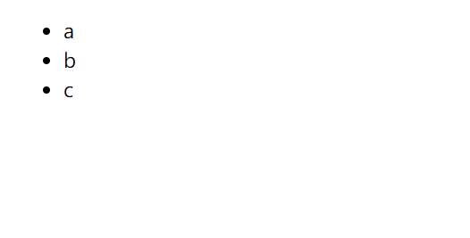
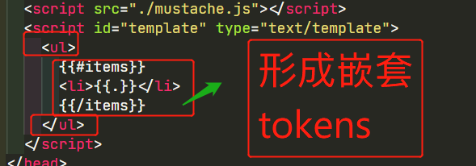
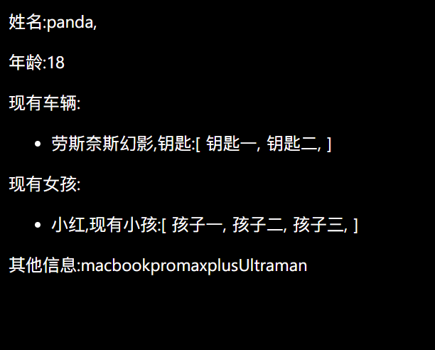

## 什么是 mustache 模板

mustache 模板是一种将数据转换为视图的技术!相比于`jq石器时代`拼接字符创,纯操作 dom 等方式,在当时这项技术是具有突破和轰动性的!为后来的模板引擎提供了很好的借鉴思路!从某种意义上来说,它是`vue编译`和`jsx`等技术的祖先!而`vue`使用的就是这种技术!

## 简单的使用

[NPM 地址](https://www.npmjs.com/package/mustache)
也可以直接在项目中引用 cdn 来使用

下边我们来演示一下简单的使用,go!🏄

我们先准备好这样一个 html 文件,这里值得一提的是,`script`标签内的`text/template`类型其实是浏览器不认识的,我们正好利用这一特性来保存我们的模板 😁

```html
<!DOCTYPE html>
<html lang="zh">
  <head>
    <meta charset="UTF-8" />
    <meta http-equiv="X-UA-Compatible" content="IE=edge" />
    <meta name="viewport" content="width=device-width, initial-scale=1.0" />
    <title>Document</title>
    <script src="./mustache.js"></script>
    <script id="template" type="text/template">
      <ul>
        {{#items}}
        <li>{{.}}</li>
        {{/items}}
      </ul>
    </script>
  </head>
  <body>
    <div id="app"></div>
  </body>
</html>
```

然后就来到数据部分了,通过将数据和视图都输送给 mustache 这个库

```js
const items = ["a", "b", "c"];
const data = { items };
const dom = mustache.render(
  document.getElementById("template").innerHTML,
  data
);
document.getElementById("app").innerHTML = dom;
```

然后我们就看到了这样的页面


wow,遥想当年疯狂拼接字符串的日子,出现这类技术,简直是内牛满面啊!😭

可以看到和 vue 的使用方式其实是差不多的,只是有一些差异,比如 for 循环的方式.

## 这玩意是怎么实现的呢?

答案是拼接字符串.😁.'啊这?',莫着急,它的方式是好很多的.

### tokens

它里边有一个概念叫 tokens,它的作用是将模板分割成一块一块的,如果遇到嵌套的情况,就会形成多维数组,也就是形成嵌套的 tokens.然后将 tokens 转换为字符串,形成最终的字符串!虽然也是拼接字符串,但是体验可是好上一万倍啊!


就形如上边的字符串模板,mustache 会在碰到`{{}}`将模板分割,你可以理解为像数组的`split`方法一样,我们得到的 tokens 长度为 3,但是总的 tokens 的数量可不是 3,因为我们还有嵌套的 tokens(看图)!然后将 tokens 再结合我们给到的数据转换为`html`字符串,我们最终放到容器中,页面就渲染完成啦!😁

### 接下来我们来实现一下吧

```js
// 扫描类
class Scanner {
  constructor(templateStr) {
    this.templateStr = templateStr;
    // 指针
    this.pos = 0;

    this.tail = "";
  }
  // 让指针走过指定的内容
  scan(str) {
    this.pos += str.length;
    this.tail = this.templateStr.substring(this.pos);
  }
  // 让指针走到指定标记的位置,并返回走过的字符串
  scanUtil(endFlag) {
    const index = this.pos;
    while (!this.eos() && !this.tail.startsWith(endFlag)) {
      this.pos++;
      this.tail = this.templateStr.substring(this.pos);
    }
    const result = this.templateStr.substring(index, this.pos);
    this.scan(endFlag);
    return result;
  }
  // 负责终点检查
  eos() {
    return this.pos >= this.templateStr.length;
  }
}

// 将模板字符窜转换为tokens数组
const parseTemplateToTokens = (templateString) => {
  const tokens = [];
  const sc = new Scanner(templateString);
  let words;
  while (!sc.eos()) {
    // 寻找开始标记之前的文字
    words = sc.scanUtil("{{");
    tokens.push(["text", words]);
    // 寻找开始标记与结束标记之间的文字
    words = sc.scanUtil("}}");
    if (words !== "") {
      //  解析嵌套情况
      if (words[0] === "#") {
        //嵌套开始标记
        tokens.push(["#", words.substring(1)]);
      } else if (words[0] === "/") {
        //嵌套结束标记
        tokens.push(["/", words.substring(1)]);
      } else {
        // 非嵌套
        tokens.push(["name", words]);
      }
    }
  }
  // 到这里tokens是打平的一维数组,我们需要将其折叠为多维数组来满足嵌套关系
  return nestTokens(tokens);
};

// 折叠嵌套的tokens
const nestTokens = (tokens) => {
  const nestedTokens = [];
  // 收集器,用来指向我们正在操作的元素的折叠项
  let collector = nestedTokens;
  // 维护一个栈的数据结构,保证栈顶永远是我们正在操作的元素
  const stack = [];
  for (let i = 0; i < tokens.length; i++) {
    const token = tokens[i];
    switch (token[0]) {
      case "#":
        collector.push(token);
        stack.push(token);
        // 给token添加第三项数组项,并让收集器指向它
        collector = token[2] = [];
        break;
      case "/":
        stack.pop();
        if (!stack.at(-1)) {
          collector = nestedTokens;
          break;
        }
        collector = stack.at(-1)[2];
        break;
      default:
        collector.push(token);
        break;
    }
  }
  return nestedTokens;
};

// tokens render 单层级
const tokensRender = (tokens, data) => {
  let result = "";
  tokens.forEach((t, i) => {
    const type = t[0];
    console.log(t);
    if (type === "text") {
      // 普通文本
      result += t[1];
    } else if (type === "name") {
      // key value
      const key = t[1];
      if (key === ".") {
        result += data;
      } else {
        // 解决连续键
        const paths = key.split(".");
        // 指针
        let point = data;
        paths.forEach((path) => {
          point = point[path];
        });

        result += point;
      }
    } else {
      const key = t[1];
      const nestTokens = t[2];
      const nestData = data[key];
      const str = parseArrayTokens(nestTokens, nestData);
      result += str;
    }
  });
  return result;
};

// 解析嵌套tokens
const parseArrayTokens = (toenks, array) => {
  let result = "";
  array.forEach((node) => {
    // 这里我们循环交替调用,形成一个递归效果
    result += tokensRender(toenks, node);
  });
  return result;
};

const pandaTemplate = {
  render(template, data) {
    const tokens = parseTemplateToTokens(template);
    const htmlStr = tokensRender(tokens, data);
    return htmlStr;
  },
};
```

上边的代码我们就实现了一个基本的模板引擎啦,每个函数都有详细的注释,我们可以使用下边的代码来测试一下

```html
<div id="app"></div>
<script>
  // 开始使用

  const data = {
    name: "panda",
    age: 18,
    info: {
      pc: {
        type: "macbookpromaxplusUltraman",
      },
    },
    cars: [
      {
        name: "劳斯奈斯幻影",
        keys: ["钥匙一", "钥匙二"],
      },
    ],
    girls: [
      {
        name: "小红",
        children: [
          {
            name: "孩子一",
            age: 8,
          },
          {
            name: "孩子二",
            age: 9,
          },
          {
            name: "孩子三",
            age: 10,
          },
        ],
      },
    ],
  };
  const htmlStr = pandaTemplate.render(
    `
      <div>
      <p>姓名:{{name}},</p>
      <p>年龄:{{age}}</p>
      现有车辆:
      <ul>
        {{#cars}}
        <li>{{name}},钥匙:[ {{#keys}} {{.}}, {{/key}} ]</li>
        {{/cars}}
      </ul>
      现有女孩:
      <ul>
        {{#girls}}
        <li>
          {{name}},现有小孩:[ {{#children}}<sapn>{{name}},</sapn> {{/children}} ]
        </li>
        {{/girls}}
      </ul>
      <p>其他信息:{{info.pc.type}}</p>
    </div>
                  `,
    data
  );

  document.getElementById("app").innerH;
  TML = htmlStr;
</script>
```

然后就可以看见这样的视图



ok,这样就基本完成啦!可以在每个函数的关键部分打印一下,看看每个函数的作用,这样就能很快整个流程和实现细节啦~

## 总结

没有什么好说的,加油!
